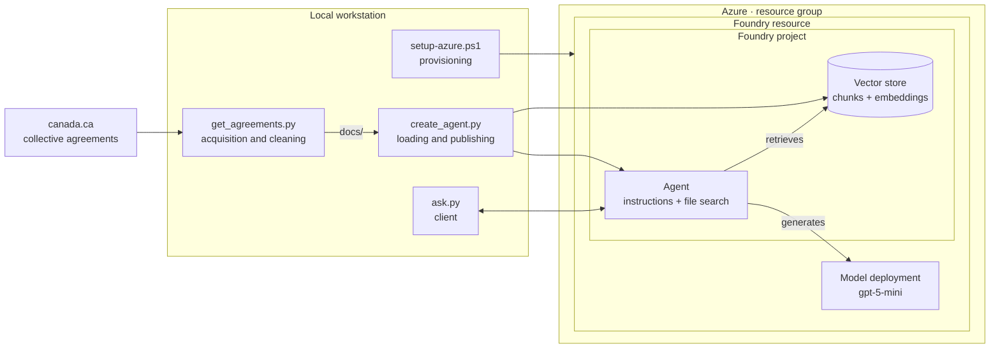
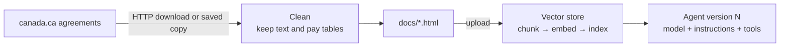
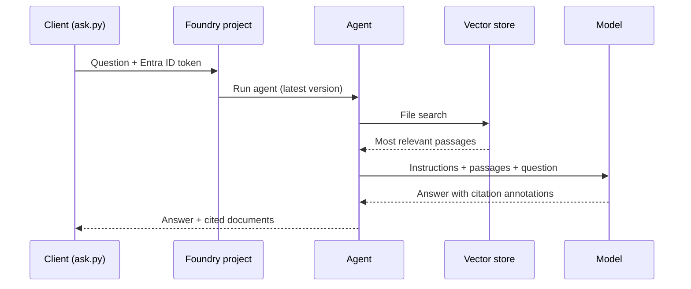

# GC Pay Agent

A retrieval-augmented AI agent that answers questions about Government of Canada collective agreements, grounding every answer in the agreement text and citing its source.

Built on **Microsoft Foundry Agent Service**, the agent pairs a standard foundation model with retrieval over the published Treasury Board agreements. Infrastructure, data ingestion and the agent definition are all defined in code, so the whole system can be reproduced, versioned and torn down from the command line.

## Contents

- [Overview](#overview)
- [Example](#example)
- [Architecture](#architecture)
- [How it works](#how-it-works)
- [Design principles](#design-principles)
- [Evaluation](#evaluation)
- [Tech stack](#tech-stack)
- [Getting started](#getting-started)
- [Configuration](#configuration)
- [Usage](#usage)
- [Project structure](#project-structure)
- [Security and identity](#security-and-identity)
- [Operations](#operations)
- [Troubleshooting](#troubleshooting)
- [Roadmap](#roadmap)
- [Limitations](#limitations)
- [Data source](#data-source)

## Overview

Collective agreements govern pay, leave, overtime and working conditions for federal public servants. They are long, dense documents with many similar rules and pay tables, and finding a specific answer, such as a leave entitlement or an overtime rate, means locating the right article in the right agreement.

GC Pay Agent answers these questions in plain language:

- **Grounded answers.** Responses are generated only from passages retrieved from the agreements, not from the model's general knowledge.
- **Citations.** Every answer names the agreement and article it relied on, and the client lists the source documents.
- **Clarifying questions.** When an answer depends on details the user hasn't given, such as the agreement, group, level or years of service, the agent asks rather than guesses.
- **Exact figures.** Rates and amounts are quoted as written in the agreement, never rounded or estimated.
- **Reproducible.** One script provisions the Azure resources; two scripts load the documents and publish a new, versioned agent.

The current release covers the **Program and Administrative Services (PA)**, **Economics and Social Science Services (EC)** and **Information Technology (IT)** agreements. Additional agreements can be added with a one-line change.

## Example

```text
> python ask.py "How much vacation leave do I earn after 8 years under PA?"

Under the PA agreement (Article 34, Vacation leave with pay), ...

  Sources: pa-collective-agreement.html
```

Multi-turn chat is also supported, so follow-up questions keep their context:

```text
> python ask.py
You: How much vacation leave do I earn after 8 years under PA?
...
You: And after 16 years?
...
```

## Architecture



The system has two pipelines that run independently.

**Ingestion** runs when the source documents change. It turns published web pages into a searchable knowledge store and publishes an agent version that uses it.



**Query** runs for every question. The agent retrieves relevant passages, then generates a grounded answer with citations.



### Components

| Layer | Component | Responsibility |
| --- | --- | --- |
| Source | Treasury Board collective agreements | Authoritative content, published on canada.ca |
| Ingestion | `get_agreements.py` | Acquire each agreement and reduce it to the agreement text and tables |
| Ingestion | `create_agent.py` | Load documents into the vector store and publish the agent |
| Knowledge store | Foundry vector store | Chunking, embeddings and hybrid (semantic + keyword) search |
| Reasoning | Foundry prompt agent | Applies the instructions, decides when to search, assembles citations |
| Model | Azure OpenAI deployment (`gpt-5-mini`, GlobalStandard) | Generates answers from retrieved passages |
| Client | `ask.py` | Single-question and conversational access from the terminal |
| Identity | Microsoft Entra ID, Azure RBAC | Keyless authentication; data-plane authorization |
| Platform | Resource group, Foundry resource, Foundry project | Hosting, quotas, billing boundary |

## How it works

### 1. Provisioning

`setup-azure.ps1` creates every Azure resource the agent depends on, using the Azure CLI:

1. A resource group.
2. A Foundry resource (`kind: AIServices`) with a system-assigned managed identity, a custom subdomain and project management enabled.
3. A Foundry project inside the resource.
4. A model deployment (`gpt-5-mini`, GlobalStandard SKU) with configurable capacity in thousands of tokens per minute.
5. A **Foundry User** role assignment for the signed-in user at project scope, granting data-plane access to create and invoke agents.

The script is idempotent. Each step checks for an existing resource before creating it, and the deployment's capacity is reconciled to the requested value on every run. The Foundry resource name is derived from the subscription ID, so repeated runs always target the same resources. On completion, the script writes the project endpoint and deployment name to `.env`.

### 2. Document acquisition and cleaning

`get_agreements.py` retrieves each agreement's page from canada.ca and isolates the agreement content:

- Only the page's `<main>` element is kept. Scripts, styles, navigation, forms, buttons and site furniture such as page details and footers are removed.
- Output is saved as **HTML rather than plain text**, preserving the row and column structure of pay tables so that rates stay associated with the correct group, level and step.
- Each output file records its source URL in a `<meta name="source">` tag for traceability.
- Downloads use standard browser headers with retries. If a page can't be downloaded, the script uses a copy saved manually to `raw/<code>.html`, which keeps ingestion working when the source site rate-limits automated clients.

### 3. Loading and publishing

`create_agent.py` performs two operations:

**Loading the knowledge store.** Cleaned documents are uploaded to a Foundry vector store (`gc-agreements`). The service splits each document into chunks, generates embeddings and builds a hybrid index supporting semantic and keyword search. An existing vector store is reused by default; `--reload` deletes its files and rebuilds it from the current documents.

**Publishing the agent.** The agent is defined declaratively as a `PromptAgentDefinition`:

| Element | Source | Purpose |
| --- | --- | --- |
| Model | `MODEL_DEPLOYMENT` in `.env` | Generates the answers |
| Instructions | `agent/instructions.md` | Behavioural rules: grounding, citation, clarification, exact figures |
| Tools | `FileSearchTool` bound to the vector store | Retrieval over the agreements |

Each run publishes a **new agent version**. Because the instructions live in version control, every agent version maps to a specific commit, which allows like-for-like comparison of prompt changes.

### 4. Answering questions

`ask.py` sends questions through the project's OpenAI-compatible Responses API, referencing the agent by name so the latest version handles the request. Authentication uses `DefaultAzureCredential`, which reuses the Azure CLI session; no keys are involved.

For each request, the agent runs file search against the vector store, passes the retrieved passages and its instructions to the model, and returns an answer annotated with file citations. The client prints the answer, then resolves the citation annotations to document names. In chat mode, a server-side conversation keeps context across turns.

## Design principles

| Principle | Rationale |
| --- | --- |
| **Foundation model with retrieval, not fine-tuning** | Agreements are renegotiated and answers must be traceable. Retrieval updates by reloading documents and cites its sources; fine-tuning would require retraining on every change and cannot cite. The model's weights are never modified; all customization happens in the documents, retrieval, instructions and tools around it. |
| **Grounding over general knowledge** | Instructions restrict answers to retrieved passages and require the agent to say so when the agreements don't cover a question. |
| **Everything as code** | Provisioning, ingestion and the agent definition are scripted and versioned, so the system can be reproduced, reviewed and rolled back. |
| **Keyless by default** | Entra ID authentication and RBAC replace API keys and connection strings. |
| **Separation of pipelines** | Ingestion and query run independently, so documents can be refreshed without touching the client, and vice versa. |
| **Deterministic logic outside the model** | Calculations that must be exact belong in code, with the model handling language and retrieval (see [Roadmap](#roadmap)). |

## Evaluation

Answer quality is measured against a fixed test set in [`eval/questions.yaml`](eval/questions.yaml), so every change to the documents, retrieval, instructions or model can be compared like for like.

| Question type | What it checks |
| --- | --- |
| **Answer** (30) | The agent gives the correct entitlement, rate or condition for PA, EC and IT, and cites the right document and article |
| **Clarify** | When the question is ambiguous, the agent asks which agreement or details apply instead of guessing |
| **Refuse** | When the agreements don't cover a question, including an instruction to "just guess", the agent says so instead of inventing an answer |

Each expected answer records the clause it was checked against. `eval/run_eval.py` sends every question to the agent and grades each answer in two ways:

- **Correctness** is graded by a model acting as a judge, which compares the answer with the verified reference and returns *correct*, *partial* or *incorrect* with a reason.
- **Citations** are checked deterministically: the expected document must be among the cited files, and the answer must reference the expected article or clause.

Each run also records response time, token usage and cost per answer, along with the git commit and a hash of the agent's instructions, so every result can be traced to the exact configuration that produced it. Results are written to `eval/results/` as a per-question log (`.jsonl`) and a summary (`.md`).

```powershell
python eval/run_eval.py                    # full test set
python eval/run_eval.py --type refuse      # one question type
python eval/run_eval.py --ids pa-01 it-06  # specific questions
```

**Status:** the test set is complete, and the expected answers are being verified against the agreements. Results will be published here after the first full run.

## Tech stack

| Area | Technology |
| --- | --- |
| Agent runtime | Microsoft Foundry Agent Service (prompt agents) |
| Model | Azure OpenAI `gpt-5-mini` |
| Retrieval | Foundry file search (managed vector store, hybrid search) |
| SDKs | `azure-ai-projects` 2.x, OpenAI Python client, `azure-identity` |
| Ingestion | Python, `requests`, Beautiful Soup |
| Evaluation | Python, model-graded correctness, deterministic citation checks |
| Provisioning | PowerShell, Azure CLI |
| Identity | Microsoft Entra ID, Azure RBAC (Foundry User role) |

## Getting started

### Prerequisites

- An Azure subscription with permission to create resources and assign roles (Owner, or Contributor plus User Access Administrator)
- [Azure CLI](https://learn.microsoft.com/cli/azure/install-azure-cli) 2.80 or later
- Python 3.10 to 3.13 (3.12 recommended). Newly released Python versions may not yet have prebuilt packages for every dependency.
- PowerShell (Windows PowerShell 5.1 or PowerShell 7)

### Installation

```powershell
git clone https://github.com/<your-username>/gc-pay-agent.git
cd gc-pay-agent

# Sign in and provision Azure resources (writes .env)
az login
.\setup-azure.ps1

# Python environment (any version from 3.10 to 3.13)
py -3.12 -m venv .venv
.\.venv\Scripts\Activate.ps1
pip install -r requirements.txt

# Ingest the agreements and publish the agent
python get_agreements.py
python create_agent.py
```

### Provisioning options

```powershell
.\setup-azure.ps1 -ListModels                                   # models available in the region
.\setup-azure.ps1 -Location eastus2                             # different region
.\setup-azure.ps1 -ModelName <name> -ModelVersion <version>     # different model
.\setup-azure.ps1 -Capacity 100                                 # higher rate limit (thousands of tokens per minute)
```

## Configuration

`.env` is generated by `setup-azure.ps1` and excluded from version control. `.env.example` documents the expected values.

| Variable | Description | Example |
| --- | --- | --- |
| `PROJECT_ENDPOINT` | Foundry project endpoint | `https://<resource>.services.ai.azure.com/api/projects/gc-pay-agent` |
| `MODEL_DEPLOYMENT` | Model deployment name used by the agent | `gpt-5-mini` |
| `AGENT_NAME` | Name of the agent to create and invoke | `gc-pay-agent` |

Agent behaviour is configured in [`agent/instructions.md`](agent/instructions.md). The agreements to ingest are listed in `AGREEMENTS` in [`get_agreements.py`](get_agreements.py).

## Usage

| Task | Command |
| --- | --- |
| Ask a single question | `python ask.py "<question>"` |
| Start a conversation | `python ask.py` (type `exit` to end) |
| Publish a new agent version after editing the instructions | `python create_agent.py` |
| Refresh the documents | `python get_agreements.py`, then `python create_agent.py --reload` |
| Evaluate the agent | `python eval/run_eval.py` |
| Add an agreement | Add its code to `AGREEMENTS` in `get_agreements.py`, update `agent/instructions.md`, then refresh the documents |

## Project structure

```text
gc-pay-agent/
├── agent/
│   └── instructions.md     # Agent instructions (system prompt)
├── eval/
│   ├── questions.yaml      # Test set with verified expected answers
│   ├── run_eval.py         # Runs and grades the test set
│   └── results/            # Run logs and summaries
├── setup-azure.ps1         # Provisions Azure resources; writes .env
├── get_agreements.py       # Acquires and cleans the agreements into docs/
├── create_agent.py         # Loads the vector store; publishes agent versions
├── ask.py                  # Command-line client
├── common.py               # Shared configuration, authentication and helpers
├── requirements.txt        # Python dependencies
├── .env.example            # Configuration template
└── .gitignore              # Excludes .env, .venv, docs/, raw/
```

Generated at runtime and not committed: `docs/` (cleaned agreements), `raw/` (optional manually saved pages), `.env`, `.venv/`.

## Security and identity

- **No secrets in code.** All Azure access uses Microsoft Entra ID tokens via `DefaultAzureCredential`. The repository contains no keys or connection strings, and `.env` holds only non-secret identifiers.
- **Least privilege at the data plane.** Managing Azure resources (control plane) and using the agent (data plane) are authorized separately. Users of the agent need only the Foundry User role on the project.
- **Public source data.** The knowledge store contains only publicly published agreements; no personal or employee data is processed.
- **Managed storage.** This configuration uses Foundry's basic agent setup, in which file search storage is managed by Microsoft. Workloads with data residency or classification requirements, such as Protected B, should use the standard agent setup with customer-owned storage and search in a Canadian region, private networking, and logging to a customer-controlled workspace.

## Operations

- **Rate limits.** The model deployment's capacity is expressed in thousands of tokens per minute. File search adds retrieved passages to every prompt, so capacity should allow several thousand tokens per question. Requests above the limit return HTTP 429; increase capacity with `.\setup-azure.ps1 -Capacity <n>`, within the subscription's quota.
- **Cost.** The Foundry resource has no idle cost. Charges accrue per model token and for vector store storage.
- **Teardown.** `az group delete -n rg-gc-pay-agent --yes --no-wait` removes all resources. Foundry resources are soft-deleted; to reprovision with the same name before the retention period ends, purge it first with `az cognitiveservices account purge -l <region> -g rg-gc-pay-agent -n <resource-name>`.

## Troubleshooting

| Symptom | Resolution |
| --- | --- |
| PowerShell reports that scripts are disabled or not digitally signed | `Set-ExecutionPolicy -Scope CurrentUser RemoteSigned`, then `Unblock-File .\setup-azure.ps1` |
| `get_agreements.py` times out | Save each agreement page from a browser as HTML to `raw/<code>.html` (for example `raw/pa.html`) and rerun |
| `Missing PROJECT_ENDPOINT` | Run `setup-azure.ps1` to completion; it writes `.env` |
| HTTP 401 or 403 | Role assignments can take a few minutes to propagate; retry. Confirm the Foundry User role on the project. |
| HTTP 404, agent not found | Run `create_agent.py` before `ask.py` |
| HTTP 429, rate limit exceeded | Increase the deployment's capacity (see [Operations](#operations)) |
| `pip install` fails with "Microsoft Visual C++ 14.0 or greater is required" | The Python version is newer than some dependencies support. Delete `.venv` and recreate it with a supported version: `py -3.12 -m venv .venv` |

## Roadmap

**Evaluation**
- Evaluation in CI (GitHub Actions), run whenever the agent's instructions change

**Retrieval and models**
- Foundry IQ knowledge base with agentic retrieval and customer-controlled indexing
- Model comparison on quality, latency and cost
- French-language agreements and bilingual answers

**Capabilities**
- Pay-stub verification: extract pay-stub fields, compute expected pay in code from agreement rules, and flag discrepancies with citations

**Channels**
- Voice interaction
- Event-driven routines that answer newly submitted pay questions

**Platform**
- Request tracing with Application Insights
- Reference deployment for Protected B workloads

## Limitations

- **Not official advice.** Answers are informational and not official pay, HR or legal advice. Confirm entitlements with your pay centre or HR advisor.
- **Point-in-time content.** Answers reflect the agreement versions ingested. Some agreements remain in effect past their expiry date while new agreements are negotiated.
- **Coverage.** Only the ingested agreements are searchable; questions about other groups, policies or directives fall outside the agent's scope.

## Data source

Collective agreements are published by the Treasury Board of Canada Secretariat at [canada.ca: Collective agreements for the public service](https://www.canada.ca/en/treasury-board-secretariat/topics/pay/collective-agreements.html). Documents are retrieved at ingestion time and are not redistributed in this repository.
